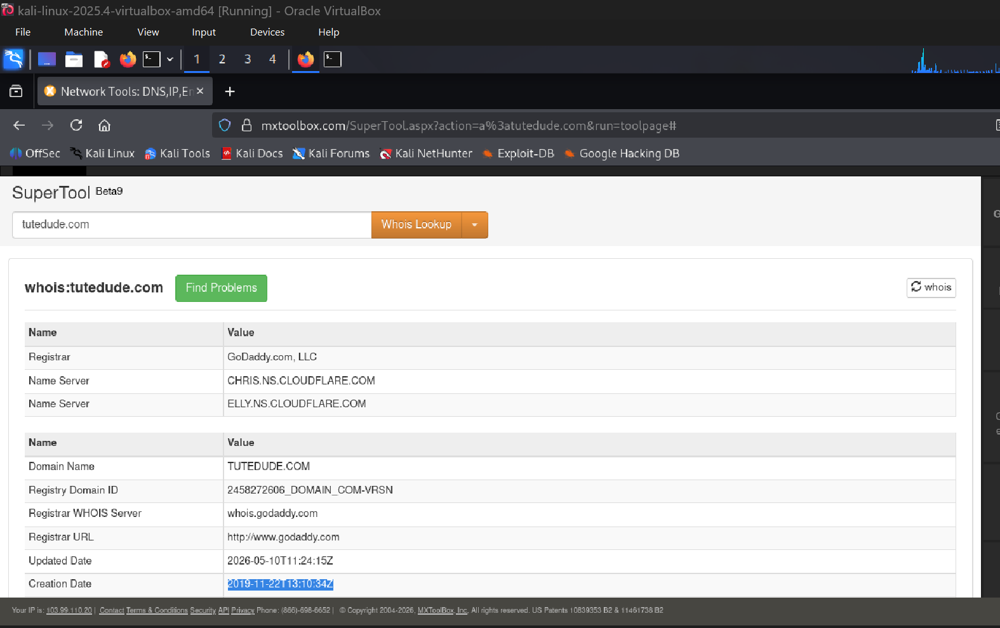
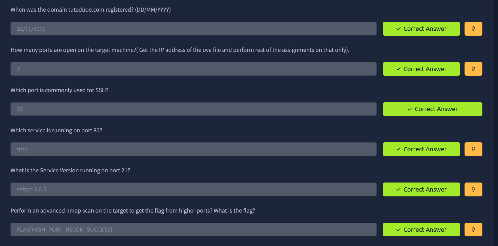

# Assignment 05 – Domain Information & Network Scanning

## Task
To answer the following questions in the TryHackMe Room:
1. When was the domain `tutedude.com` registered? (DD/MM/YYYY)  
2. How many ports are open on the target?  
3. Which port is commonly used for SSH?  
4. Which service is running on port 80?  
5. What is the Service Version running on port 21?  
6. Perform an advanced Nmap scan on the target to get the flag from higher ports.


## Approach & Solutions

### 1. Domain Registration Date
- Performed a **WHOIS lookup** for `tutedude.com`.  
- Output showed:  
  **Creation Date:** 22/11/2019 (DD/MM/YYYY format).  
  **Answer:** The domain `tutedude.com` was registered on **22/11/2019**.


### 2. Open Ports on Target
- Ran a basic Nmap scan:
  ```bash
  sudo nmap 192.168.10.5
  ```
Output showed 7 open ports:
21/tcp → FTP
22/tcp → SSH
80/tcp → HTTP
139/tcp → NetBIOS-SSN
445/tcp → Microsoft-DS
3306/tcp → MySQL
8080/tcp → HTTP-Proxy
 Answer: There are 7 open ports on the target.

3. SSH Port
By convention, SSH runs on port 22.
 Answer: SSH commonly uses port 22.

4. Service on Port 80
Port 80 is reserved for HTTP.
 Answer: The service running on port 80 is HTTP.

5. Service Version on Port 21
Ran an advanced Nmap scan with service detection:
```
bash
sudo nmap -sV 192.168.10.5
```
Output showed:
Port 21 → vsftpd 3.0.5.
 Answer: The service version running on port 21 is vsftpd 3.0.5.

6. Advanced Nmap Scan (High Ports)
Ran a verbose scan with OS detection and scripts:
```
bash
sudo nmap -sV -A -v 192.168.10.5
```
Discovered a high port 8080/tcp open.
Retrieved the flag:
```
Code
FLAG{HIGH_PORT_RECON_SUCCESS}
```
 Answer: The flag is FLAG{HIGH_PORT_RECON_SUCCESS}.

### Final Screenshot (TryHackMe Answers)
Here is the final proof of all answers submitted in the TryHackMe room:


### Key Learnings
- WHOIS lookups are useful for reconnaissance, revealing domain registration and ownership details.
- Nmap is versatile: basic scans show open ports, while advanced scans reveal service versions and hidden high ports.
- Common ports (22 for SSH, 80 for HTTP) are critical to know for penetration testing.
- Service version detection helps identify potential vulnerabilities (e.g., outdated FTP servers).
- High‑port scanning can uncover hidden services and flags in CTF environments.